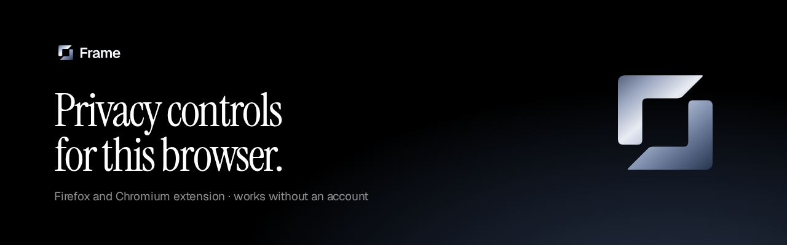
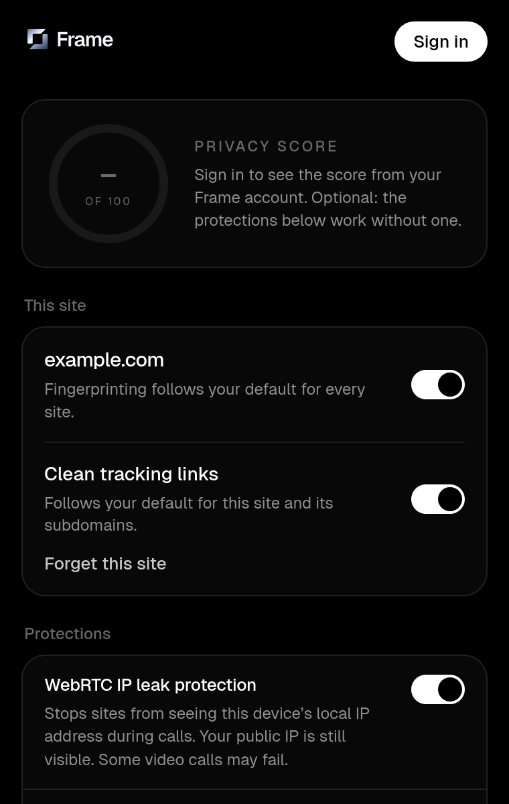

<p align="center">
  
</p>

<p align="center">
  <a href="https://addons.mozilla.org/en-US/firefox/addon/frame-privacy/"><strong>Get it for Firefox</strong></a>
  ·
  <a href="https://frameprivacy.com">frameprivacy.com</a>
  ·
  <a href="PRIVACY.md">Privacy</a>
  ·
  <a href="CHANGELOG.md">Changelog</a>
</p>

<p align="center">
  <a href="https://addons.mozilla.org/en-US/firefox/addon/frame-privacy/"></a>
  <a href="https://github.com/frameprivacy/frame-extension/actions/workflows/ci.yml"></a>
</p>

# Frame browser extension

The [Frame](https://frameprivacy.com) extension puts real browser privacy settings in one popup: WebRTC IP leak protection, clean tracking links, fingerprinting protection, Global Privacy Control, and a one-click way to forget a site. It is a Manifest V3 extension for Firefox and Chromium browsers (Chrome, Brave, Edge).

Everything works without an account. Signing in to a Frame account is optional and only adds your Privacy Score to the popup. The extension never asks for your Frame password, collects no analytics, and does not make you anonymous. It is not a VPN.

<p align="center">
  
</p>

## Install

| Browser | How |
| --- | --- |
| Firefox 128 or newer | [Get it for Firefox](https://addons.mozilla.org/en-US/firefox/addon/frame-privacy/) on Mozilla Add-ons. |
| Chrome, Brave, Edge | Not in the Chrome Web Store yet. You can build it and [load it unpacked](#load-unpacked). |

## What you get

- **The popup** shows the site you are on, with its own switches for fingerprinting protection and clean tracking links, plus **Forget this site**, which clears that site's cookies and storage on this device after you confirm.
- **Protections** are on from the first install. Each one says when the browser does not offer it, or when another extension or a policy controls it. Settings the browser does not offer are grouped under *Not offered by this browser*, so nothing pretends to work when it can't.
- **All settings** opens the options page with the full explanation of every switch, your per-site exceptions, and every permission.
- **Privacy Score (optional).** Signed in, the popup shows the same Privacy Score as your Frame dashboard, as a ring out of 100 with its band (Good 80+, Fair 60+, Needs work 40+, At risk below 40) and the score for each area Frame has checked. The number comes from the Frame API. Signed out, or before Frame has checked anything, the ring stays empty; the extension never shows a made-up score.

## What the toggles do

On a fresh install the protections are on, including clean tracking links. WebRTC and fingerprinting can break sites. Fingerprinting can be turned off for the current site from the popup. `www.example.com` and `example.com` are different sites. Clean tracking links can be turned off per site too; the browser then also leaves subdomains of that site alone.

Each browser setting shows when Frame cannot change it: another extension has it, or a policy locked it. Topics, Protected Audience, and ad measurement can only be turned **off** by an extension. Turning Frame’s toggle off clears Frame’s choice and leaves the browser default. Frame does not write `true` to those settings, because the browser rejects it.

| Toggle | What it actually does |
| --- | --- |
| WebRTC IP leak protection | Sets `webRTCIPHandlingPolicy` to `disable_non_proxied_udp`. Hides the local IP from sites during calls. Does not hide your public IP. Some calls fail until you turn it off. |
| Clean tracking links | Redirects page and frame navigations so a fixed list of tracking parameters is removed (`utm_source`, `utm_medium`, `utm_campaign`, `utm_term`, `utm_content`, `utm_id`, `utm_name`, `fbclid`, `gclid`, `dclid`, `gbraid`, `wbraid`, `gclsrc`, `gad_source`, `msclkid`, `mc_eid`, `mc_cid`, `igshid`, `igsh`, `yclid`, `twclid`, `ttclid`, `_hsenc`, `_hsmi`, `mkt_tok`, `oly_anon_id`, `oly_enc_id`, `vero_id`, `vero_conv`, `ref_src`, `srsltid`, `epik`, `_kx`, `irclickid`, and the Matomo `pk_campaign`, `pk_source`, `pk_medium`, `pk_kwd`, `pk_content` parameters). `si` is removed only on YouTube and Spotify links. Names like `ref` and `id` are kept. Other requests are unchanged. The list is in `src/lib/trackers.ts`. |
| Fingerprinting protection | Main-world script at `document_start`. Normalizes canvas and WebGL readback, offline audio, `hardwareConcurrency` (to 4 or 8), `deviceMemory` (to 8), and system font checks toward common values. A font the page provides itself is left alone. Blocks Local Font Access as if permission was never granted. Does not randomize a unique fingerprint. Does not change live audio, very large canvases, or text measurement, so some font guessing still works. Per site, including IPv6 and international hostnames. |
| Block third-party cookies | `thirdPartyCookiesAllowed = false` (Chromium only; Firefox does not offer this setting to extensions). The site you are on can still set its own cookies. Exemptions and the Storage Access API can still apply. |
| Global Privacy Control | `Sec-GPC: 1` via declarativeNetRequest, and `navigator.globalPrivacyControl` on the page. Sites can ignore it. Workers may not see the JavaScript flag. |
| Ad topics and measurement | Chromium only. Sets `topicsEnabled`, `fledgeEnabled` (Protected Audience), and `adMeasurementEnabled` to false when the browser has them. |
| Hyperlink auditing | `hyperlinkAuditingEnabled = false`. Stops `<a ping>`. Does not stop `sendBeacon` or pixels. |
| Network prediction | `networkPredictionEnabled = false`. Stops browser prefetch and prerender. A page can still preconnect. |
| Trim cross-site referrers | Sets the response `Referrer-Policy` to `same-origin`. A page’s own meta tag can override it. Manifest V3 cannot rewrite an existing `Referer` down to its origin on the way out. |
| Do Not Track | `doNotTrackEnabled = true`, where the browser offers it to extensions (current Firefox does not). Many sites ignore it. |
| Search suggestions | Chromium only. Stops the address bar from sending what you type to the search engine. |
| Navigation error reports | Chromium only. Stops Chrome from sending failed addresses out for alternate error pages. |
| Forget this site | Popup action, after a confirm. Clears that site’s cookies, local storage, IndexedDB, cache storage, and service workers on this device, plus the network cache when the browser can limit that to the site. Session storage is cleared in open tabs. You’ll be signed out. History is kept, and so is anything the site already stored on its servers. Chrome also clears cookies for the rest of that site’s registrable domain. Subdomains found from cookie domains are included; a parent host’s storage is not. |

Settings are applied to the regular profile. If you allow Frame in private windows, the page scripts run there too. Some browser settings cannot be changed for private windows.

## Permissions

| Permission | Why |
| --- | --- |
| `storage` | Saves toggles, per-site fingerprint exceptions, and the Frame session on this device. |
| `privacy` | Reads and sets the browser privacy settings above, and reads `levelOfControl`. |
| `identity` | Opens frameprivacy.com with `launchWebAuthFlow` and receives the redirect. Does not read a Google account. |
| `scripting` | Injects the fingerprint normalizer and the Global Privacy Control flag. |
| `declarativeNetRequest` | Sets the `Sec-GPC` request header and the `Referrer-Policy` response header, and removes tracking parameters from navigations. |
| `browsingData` | Clears cookies, storage, cache, and service workers for one site when you choose Forget this site. |
| `cookies` | Reads cookie domains so that clear can include subdomains. Cookie values are not saved or sent anywhere. |
| `http://*/*`, `https://*/*` | Those scripts and header rules have to run on the sites you visit. Frame does not read page contents into an account. |
| `https://frameprivacy.com/*` | Calls the sign-in API. Requests omit the website’s cookies. |

Tokens live in extension local storage. Sites cannot read that storage. It is not the OS keychain. Access tokens last 15 minutes. Refresh tokens last 30 days, rotate on every use, and a reused refresh token signs you out. Sign-out revokes the token. See [docs/auth.md](docs/auth.md) and [PRIVACY.md](PRIVACY.md).

## Development

Node.js 22 or newer (CI uses 22).

```bash
npm ci
npm run dev          # Chrome, reload on change
npm run dev:firefox  # Firefox, reload on change
npm test
npm run typecheck
npm run lint
```

Production bundles:

```bash
npm run build            # .output/chrome-mv3
npm run build:firefox    # .output/firefox-mv3
```

`npm run dev:stub` and `npm run build:stub` sign in to a labeled preview account (`ada@example.com`, marked *Preview data, not connected*) without calling frameprivacy.com. Use that only to look at the signed-in UI. A normal build talks to the live API in [docs/auth.md](docs/auth.md). Firefox uses `browser.identity.launchWebAuthFlow` with the same PKCE flow as Chrome, and sends `client=firefox` so the site can allow its `moz-extension://` origin.

Before a Firefox release, also run Mozilla's linter on the build:

```bash
npx web-ext lint -s .output/firefox-mv3
npx web-ext build -s .output/firefox-mv3 -a .output/web-ext
```

The version in `package.json` is the version in the manifest. See [CONTRIBUTING.md](CONTRIBUTING.md) for the release checklist.

## Load unpacked

Chrome, Brave, or Edge:

1. `npm run build`
2. Open `chrome://extensions` (or `edge://extensions`, `brave://extensions`).
3. Turn on Developer mode.
4. Load unpacked and choose `.output/chrome-mv3`.

Firefox (for development; most people should [install from Mozilla Add-ons](https://addons.mozilla.org/en-US/firefox/addon/frame-privacy/)):

1. `npm run build:firefox`
2. Open `about:debugging#/runtime/this-firefox`.
3. Load Temporary Add-on and choose `.output/firefox-mv3/manifest.json`.

## Extension ids

Set these on the site before sign-in can succeed. Details and redirect URIs are in [docs/auth.md](docs/auth.md).

| | Value |
| --- | --- |
| Chrome (`FRAME_CHROME_EXTENSION_IDS`) | `mhemokfamnabliomlhigbkclcfcplfln` |
| Firefox client id | `86d25b817a984dadbf12ae6ae90c87df43543c41` |

The Chrome id comes from the public key in `wxt.config.ts`. The private key is not in this repo. A Chrome Web Store build that Google re-signs gets a different id; add that id too.

Firefox's add-on id is `{f4a0e6c1-8b27-4d53-9e14-6c2b7a91d0e5}`. The Firefox manifest sets that id under `browser_specific_settings.gecko.id` and requests `https://frameprivacy.com/*`. Firefox does not accept a bare hostname as an add-on id, and the redirect host is SHA-1 of the add-on id. The client id in the table is that host label. Allow it the same way as the Chrome id. Also allow `Origin: moz-extension://` plus any install uuid, and read `client=firefox` on the connect URL and on token and revoke. Chrome does not send `client`.

## Scripts

| Script | |
| --- | --- |
| `npm run dev` | Chrome dev build with reload |
| `npm run dev:firefox` | Firefox dev build with reload |
| `npm run build:stub` | Chrome build signed in to the labeled preview account |
| `npm run build` | Chrome MV3 bundle |
| `npm run build:firefox` | Firefox MV3 bundle |
| `npm test` | Unit tests for settings, header rules, tracking parameters, forget-site origins, fingerprint policy, and sign-in parsing, and Privacy Score bands |
| `npm run lint` | ESLint |
| `npm run typecheck` | `wxt prepare` and `tsc --noEmit` |

Stack: [WXT](https://wxt.dev/) 0.21, TypeScript, React, Vitest. The popup and options page use Geist and the steel mark from the [Frame brand page](https://frameprivacy.com/brand).

## Links

- Firefox: [addons.mozilla.org/firefox/addon/frame-privacy](https://addons.mozilla.org/en-US/firefox/addon/frame-privacy/)
- Website: [frameprivacy.com](https://frameprivacy.com) · [Privacy policy](https://frameprivacy.com/privacy) · [Help](https://frameprivacy.com/help) · [Contact](https://frameprivacy.com/contact)
- Brand: [frameprivacy.com/brand](https://frameprivacy.com/brand)
- Support: [frameprivacy@proton.me](mailto:frameprivacy@proton.me) or a [GitHub issue](https://github.com/frameprivacy/frame-extension/issues)
